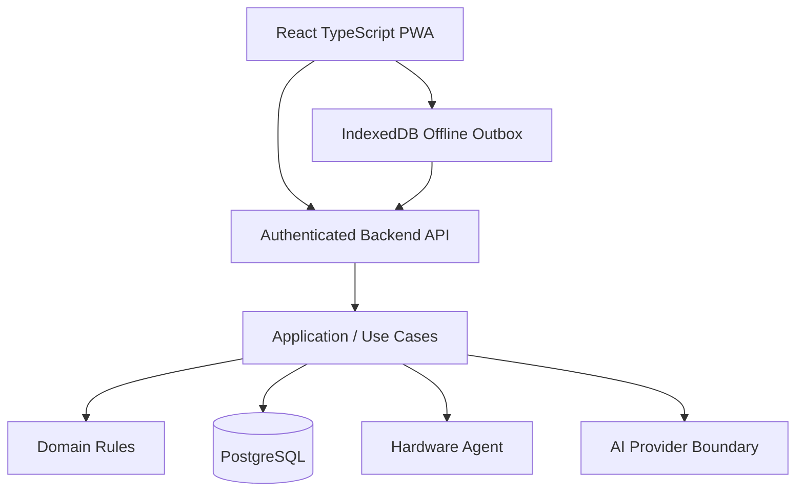

# PRODX POS — Production Handbook

**Status:** Production engineering baseline; see the dated status snapshot for current blockers  
**Source:** `Prodx-organization/PRODX-POS`  
**Reviewed baseline:** `main` at `652f2a7282d4f5b57ab1fe16bfc2bc731655b918` on 2026-10-15

> Documentation is evidence-driven. **Verified** means current repository/CI/operational evidence; **Planned** means approved direction not yet proven; **Blocked** means a required gate or dependency is unresolved; **Unverified** means proof is missing or indirect. See [Engineering Status Snapshot](STATUS-2026-10-15.md) for the latest recorded repository/PR review. This snapshot is not a live dashboard.

## 1. Production principles

- **Financial integrity:** authoritative money uses PostgreSQL NUMERIC/DECIMAL; floating point is never authoritative.
- **Inventory integrity:** stock is server-authoritative and protected by invariants, tenant scope and concurrency controls.
- **Security by default:** authentication, authorization, tenant isolation, secret handling, validation, session security and auditability are mandatory.
- **Multi-tenant isolation:** organization/store scope comes from trusted server state.
- **Offline resilience:** offline is an availability mechanism, never an authority override.
- **Auditability:** critical mutations have durable actor, tenant/store, action, target, time, correlation and outcome evidence as appropriate.
- **Idempotency:** retryable writes cannot create duplicate financial, inventory or cash effects.
- **Server authority:** the client requests; the backend finalizes identity, authorization, money, inventory, numbering and final transaction state.

## 2. Architecture



Approved direction: React/TypeScript PWA; Node.js/TypeScript backend using NestJS or equivalent modular architecture; PostgreSQL as authoritative transactional storage; server-owned synchronization; hardware-agent boundary.

Domain code must not depend directly on HTTP, browser storage, provider SDKs or concrete persistence implementations.

## 3. Authentication and authorization

1. Authenticate through the trusted server boundary.
2. Derive user, organization, store, device and session context from trusted state.
3. Never trust caller-supplied tenant identity.
4. Never persist plaintext session tokens.
5. Reject disabled devices and expired/revoked sessions.
6. Apply deterministic tenant-scoped authorization.
7. Keep provider credentials server-side.
8. Record security-sensitive outcomes according to audit policy.

Authentication success is not authorization success.

## 4. API contract

```text
Request -> Validation -> Authentication -> Trusted Context
-> Authorization -> Application Use Case -> Domain Invariants
-> Transaction/Persistence -> Audit -> Response
```

Prohibited: trusting browser tenant/user/store identity, trusting client-calculated totals, authorizing from UI state, exposing secrets/internal stack traces, or protected mutations without authentication.

Retryable writes require durable idempotency keys scoped to the authenticated tenant and operation. Concurrent requests must not create duplicate effects.

## 5. Offline synchronization

```text
POS Client -> IndexedDB Outbox -> Replay API -> PostgreSQL
                    ^                 |
                    |------ retry ----|
```

Use an explicit lifecycle such as `pending -> replaying -> completed` with `replaying -> failed -> retryable/terminal`.

Required evidence covers disconnect, durable enqueue, reconnect, replay, duplicate replay, partial failure, retry, ordering, conflict and restart recovery. The client never resolves financial or inventory conflicts by itself.

## 6. Hardware

Hardware integration belongs behind a local agent. Supported printers, cash drawers, scanners and other peripherals must have tested/certified profiles. Hardware failures must not corrupt authoritative transaction state, and arbitrary compatibility must never be claimed without evidence.

## 7. Database and migrations

PostgreSQL is authoritative. Required rules include UTC authoritative timestamps, explicit business/store timezone, tenant ownership, transactional financial/inventory mutations, explicit concurrency controls, durable idempotency and versioned migrations with one authoritative head.

Every migration must be uniquely versioned, reviewable, applicable to a supported empty database, upgradeable from the previous supported state and validated by repository migration gates.

Backup readiness requires restore evidence, not merely backup creation. The repository includes a recovery workflow that restores a logical dump into ephemeral PostgreSQL 16; provider-native backup/PITR requires separate operational evidence.

## 8. Testing and quality gates

Required layers:

1. Static/type checks
2. Unit tests
3. PostgreSQL integration tests
4. Architecture contract tests
5. Migration validation
6. Security tests
7. Critical E2E tests
8. Independent review
9. Main-branch verification

A skipped required test is not a pass. Required infrastructure must be provisioned in CI. No gate may be weakened to make CI green.

Repository scripts currently include frontend build/type-check, server type-check/unit/integration tests, theme validation, and migration execution. Consult `package.json` for exact commands and inspect workflow definitions for the required CI gates. The presence of a script is not proof it passed.

## 9. Release management

`Change -> Review -> CI -> Acceptance -> Merge -> Main Verification -> Release`

Do not force-merge around failing gates. Application rollback and database rollback are separate concerns; irreversible financial/data mutations require compensating or recovery procedures rather than blind reversal.

Record commit SHA, CI runs, test summary, migration result, security result, review/acceptance status, deployment result and relevant recovery evidence.

## 10. Incident response

**SEV-1:** financial integrity, cross-tenant access, data loss or widespread checkout outage.  
**SEV-2:** major store capability degraded with workaround.  
**SEV-3:** limited feature degradation.  
**SEV-4:** documentation/non-production issue.

Procedure: detect → protect data/financial state → establish scope → preserve evidence → mitigate safely → restore → verify financial/inventory consistency → record root cause and corrective action.

Never edit authoritative financial/inventory records merely to hide an incident.

## 11. Production-readiness gate

Production Ready requires current evidence for:

- accepted architecture and dependency-direction checks;
- authentication/authorization and tenant-isolation tests;
- business invariants and idempotency/concurrency;
- PostgreSQL integration and migration validation;
- backup/restore;
- security and secret hygiene;
- offline outbox/replay/conflict behavior;
- deployment, observability and recovery;
- all required CI checks;
- independent review;
- main verification;
- no unresolved production blocker.

A checklist or design document does not prove Production Ready. Production status must be backed by current executable evidence. The repository status snapshot currently records unresolved database readiness and Owner Console acceptance/wiring work; do not infer release readiness from this handbook.

## 12. Milestone direction

M0 Architecture/Backend Foundation → M1 Identity/Auth/RBAC → M2 Organization/Store → M3 Catalog → M4 Inventory → M5 Sales → M6 Payment/Shift/Cash → M7 Void/Refund → M8 Audit/Observability → M9 Offline/Sync → M10 Hardware → M11 Local Deployment → M12 Hybrid Deployment → M13 Enterprise Hardening → M14 Production Release.

Each milestone must pass implementation, automated tests, architecture, security, review, acceptance, merge and main-verification gates before completion.

## 13. Engineering operating model

The Owner is the product authority. AI assists and automates routine engineering work, but no AI provider is authoritative for production correctness. Provider fallback is permitted only when security, architecture, database, testing and acceptance gates remain intact.
