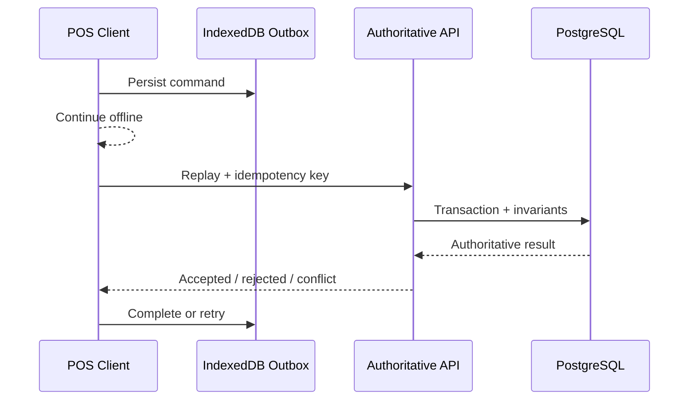

# Offline Architecture

## Lifecycle

A production command lifecycle should be explicit, for example `pending -> replaying -> completed`, with `replaying -> failed -> retryable/terminal`.

Commands must not remain permanently in a received-only state.

## Conflict authority

The client never resolves financial or inventory conflicts by itself. The server returns the authoritative outcome.
